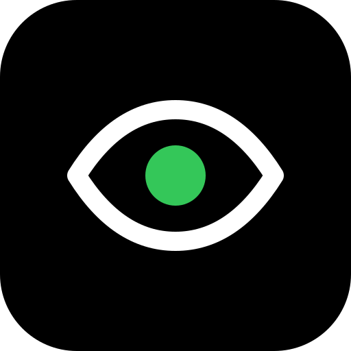
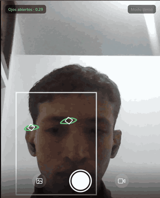
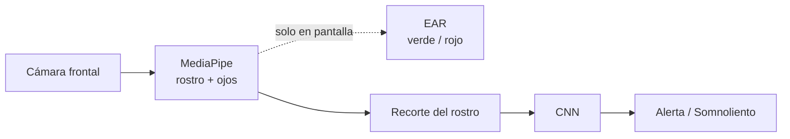

<div align="center">



# Detector de somnolencia

Clasificación binaria de somnolencia en conductores mediante redes neuronales convolucionales a partir de imágenes faciales.


-black?style=flat-square)




</div>

## Qué hace

Usa la **cámara frontal** del celular para detectar el **rostro** y la **ubicación de los ojos** en tiempo real. Al capturar, recorta el rostro y una **CNN** lo clasifica como **Somnoliento** o **Alerta**.

## Cómo funciona



La foto **siempre** pasa por la CNN, que es la que decide. El EAR (qué tan abiertos están los ojos) solo se muestra en pantalla como indicador en vivo.

→ Detalle en [docs/arquitectura.md](docs/arquitectura.md)

## Avance

| Parte | Estado |
|---|---|
| App móvil con cámara frontal | ✅ Listo |
| Detección de rostro y ojos en vivo | ✅ Listo |
| Dataset de entrenamiento | 🚧 Pendiente · [docs/dataset.md](docs/dataset.md) |
| Entrenamiento de la CNN | 🚧 Pendiente · [docs/resultados.md](docs/resultados.md) |
| Backend con el modelo | 🚧 Pendiente |

> [!NOTE]
> Mientras no exista la CNN, la app funciona en **modo demo**: el resultado sale de una regla simple con el EAR, no del modelo.

## Ejecutar

```bash
cd frontend
python -m http.server 5500
```

Abrir <http://localhost:5500> y permitir la cámara. Para probar en el celular ver [frontend/README.md](frontend/README.md).

## Estructura

```
├── frontend/   App web móvil (HTML + CSS + JS, MediaPipe)
└── docs/       Arquitectura, dataset y resultados
```

## Equipo

- David Orlando Hernández Murillo
- Kevin Jesús Parada Castillo
- Ronald Santiago Tineo Niño

<sub>Universidad de Pamplona · Sistemas Inteligentes · Proyecto de curso</sub>
