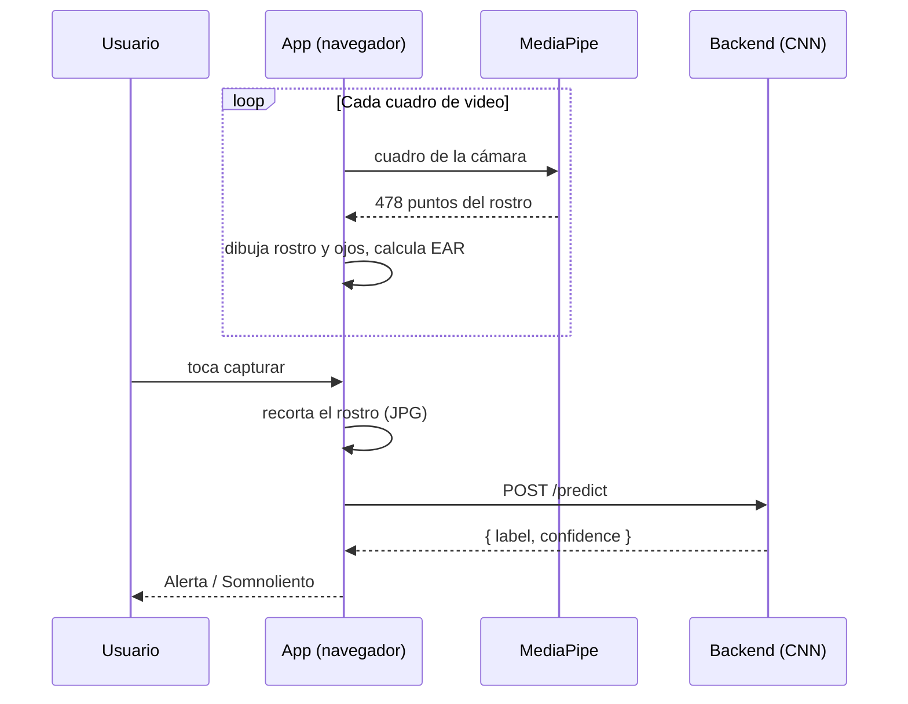

# Arquitectura

[← Volver al README](../README.md)

## Flujo completo



## 1. Detección de rostro y ojos

Se usa [MediaPipe Face Landmarker](https://ai.google.dev/edge/mediapipe/solutions/vision/face_landmarker), que corre en el navegador y devuelve 478 puntos del rostro por cuadro. Con ellos se dibuja:

- El recuadro del rostro (mínimos y máximos de todos los puntos).
- El contorno de cada ojo y el iris.

## 2. EAR (Eye Aspect Ratio)

Indicador de qué tan abiertos están los ojos: es el **alto del ojo dividido entre su ancho**. Ojo abierto ≈ 0.27, ojo cerrado ≈ 0.10.

```
 Ojo abierto              Ojo cerrado
   ╭───────╮
  (    ●    )             ───────────
   ╰───────╯
```

> [!NOTE]
> El EAR **no decide el resultado**. Solo pinta los ojos de verde o rojo en pantalla. Quien clasifica es la CNN, que además ve otras señales (bostezos, cabeza caída). La única excepción es el modo demo, mientras la CNN no exista.

Se calcula con 6 puntos por ojo:

$$EAR = \frac{\lVert p_2 - p_6 \rVert + \lVert p_3 - p_5 \rVert}{2\,\lVert p_1 - p_4 \rVert}$$

| Ojo | Índices MediaPipe (p1 … p6) |
|---|---|
| Izquierdo | 362, 385, 387, 263, 373, 380 |
| Derecho | 33, 160, 158, 133, 153, 144 |

Se promedian los dos ojos. Por debajo de **0.18** se consideran cerrados.

> [!IMPORTANT]
> El umbral es provisional: una cara sonriendo con los ojos abiertos da ~0.21. Hay que calibrarlo con el dataset.

## 3. Recorte del rostro

Antes de enviar la imagen a la CNN se recorta un cuadrado centrado en el rostro, con un margen del 30 %. Así el modelo recibe solo la cara y no el fondo.

## 4. Clasificación (CNN)

🚧 Pendiente. Aquí irá la arquitectura de la red (capas, tamaño de entrada, función de pérdida).

**Contrato del backend:**

```
POST /predict   (multipart/form-data, campo "file")
→ { "label": "drowsy" | "non_drowsy", "confidence": 0.0 – 1.0 }
```

Sin backend, la app usa un **modo demo** con la regla del EAR.
